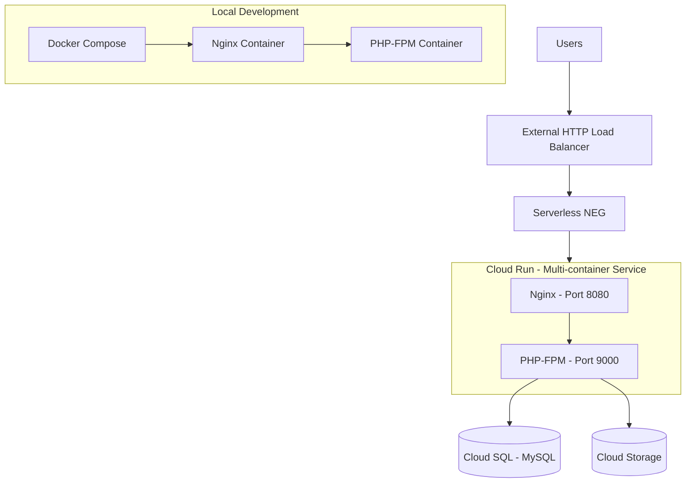

# DevOps Assessment

A containerized PHP application deployed on Google Cloud using Terraform and GitHub Actions.

The application demonstrates file uploads to Google Cloud Storage and metadata storage in Cloud SQL (MySQL), served through Nginx and PHP-FPM.

## Architecture



## Technology Stack

- **Application:** PHP 8.3
- **Web server:** Nginx
- **Application runtime:** PHP-FPM
- **Containers:** Docker and Docker Compose
- **Infrastructure:** Terraform
- **Cloud platform:** Google Cloud
- **CI/CD:** GitHub Actions
- **Database:** Cloud SQL for MySQL
- **File storage:** Google Cloud Storage

## Local Development

### Prerequisites

- Docker
- Docker Compose

### Run the application

From the project root:

```bash
docker compose -f app/docker-compose.yml up -d --build
```

Access the application:

```text
http://localhost:8081
```

Check application health:

```bash
curl http://localhost:8081/health.php
```

Check dependency readiness:

```bash
curl http://localhost:8081/ready.php
```

The readiness endpoint checks database and storage connectivity. It may return `503` until the Google Cloud services are configured.

### Stop the application

```bash
docker compose -f app/docker-compose.yml down
```

## Project Structure

```text
.
├── app/                  # PHP application and Docker configuration
├── infrastructure/
│   ├── terraform/        # Terraform configuration and modules
│   └── scripts/          # Deployment utility scripts
├── .github/workflows/    # CI/CD workflows
└── README.md
```

## Deployment Status

- [x] PHP application containerization
- [x] Nginx and PHP-FPM integration
- [x] Local Docker Compose testing
- [x] Terraform infrastructure configuration
- [ ] Google Cloud provisioning and deployment
- [ ] GitHub Actions CI/CD verification
- [ ] Public IP retrieval script verification
