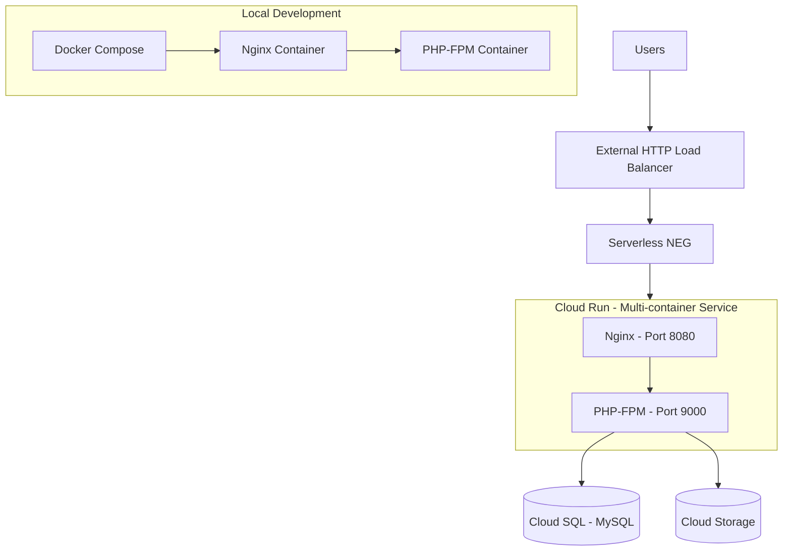

# DevOps Assessment

A containerized PHP application deployed on Google Cloud using Terraform and GitHub Actions.

The application demonstrates file uploads to Google Cloud Storage and metadata storage in Cloud SQL (MySQL), served through Nginx and PHP-FPM.

## Architecture



## Technology Stack

- **Application:** PHP 8.3
- **Web server:** Nginx
- **Application runtime:** PHP-FPM
- **Containers:** Docker and Docker Compose
- **Infrastructure:** Terraform
- **Cloud platform:** Google Cloud
- **CI/CD:** GitHub Actions
- **Database:** Cloud SQL for MySQL
- **File storage:** Google Cloud Storage

## Local Development

### Prerequisites

- Docker
- Docker Compose

### Run the application

From the project root:

```bash
docker compose -f app/docker-compose.yml up -d --build
```

Access the application:

```text
http://localhost:8081
```

Check application health:

```bash
curl http://localhost:8081/health.php
```

Check dependency readiness:

```bash
curl http://localhost:8081/ready.php
```

The readiness endpoint checks database and storage connectivity. It may return `503` until the Google Cloud services are configured.

### Stop the application

```bash
docker compose -f app/docker-compose.yml down
```

## Project Structure

```text
## Project Structure

.
├── app/                  # PHP application and Docker configuration
├── infrastructure/
│   ├── terraform/
│   │   ├── bootstrap/    # Creates the Terraform remote state bucket
│   │   ├── modules/      # Reusable infrastructure modules
│   │   ├── environments/ # Environment-specific variable examples
│   │   └── *.tf          # Root Terraform configuration
│   └── scripts/          # Utility scripts
├── .github/
│   └── workflows/        # CI/CD workflows
└── README.md
```

## Infrastructure

Infrastructure is managed using Terraform and is located in `infrastructure/terraform/`.

### Terraform Modules

| Module | Responsibility |
|---|---|
| `artifact-registry` | Stores application Docker images |
| `cloud-run` | Deploys Nginx and PHP-FPM containers |
| `cloud-sql` | Provisions the MySQL database |
| `storage` | Creates the Cloud Storage bucket |
| `load-balancer` | Configures external HTTP traffic routing |

Additional root configuration files define IAM permissions, service accounts, secrets, variables, outputs, and provider settings.

### Configuration

Copy the example environment file:

```bash
cp infrastructure/terraform/environments/dev.tfvars.example \
   infrastructure/terraform/environments/dev.tfvars
```

Update the values for your Google Cloud project, bucket, database, and container images.

The database password is supplied separately:

```bash
export TF_VAR_db_password="YOUR_DATABASE_PASSWORD"
```

### Terraform State and Initialization

Terraform uses a Google Cloud Storage (GCS) remote backend to store infrastructure state.

The remote state bucket is created separately using the bootstrap configuration. Once created, the main Terraform configuration uses this bucket to store and manage its state.

This keeps the state centralized rather than relying on a local `terraform.tfstate` file and allows authorized team members to work with the same infrastructure state.

The state bucket has:

- Uniform bucket-level access.
- Public access prevention.
- Object versioning enabled.

Restrict access to the bucket because Terraform state can contain sensitive information.

The bootstrap configuration maintains its own local Terraform state, while the main infrastructure configuration uses the GCS remote backend.

Create the state bucket:

```bash
cd infrastructure/terraform/bootstrap

terraform init -backend=false
terraform plan
terraform apply
```

After creating the bucket, update `backend.tf` with its actual name.

Initialize the main Terraform configuration:

```bash
cd ..
terraform init
terraform validate
terraform plan -var-file=environments/dev.tfvars
```

Review the execution plan before applying:

```bash
terraform apply -var-file=environments/dev.tfvars
```

### Deployment Sequence

The initial deployment requires the following order:

1. Create the Terraform state bucket using the bootstrap configuration.
2. Configure the GCS backend and initialize the main Terraform configuration.
3. Create the Artifact Registry repository.
4. Build and push the initial Nginx and PHP-FPM images.
5. Configure the image references in `dev.tfvars`.
6. Apply the full Terraform configuration to provision Cloud Run, Cloud SQL, Cloud Storage, and the Load Balancer.
7. Configure GitHub Actions for subsequent application deployments.

GitHub Actions builds and pushes new container images and updates the existing Cloud Run service. Terraform manages the infrastructure configuration and ignores subsequent container image changes.

### Runtime Permissions and Secrets

- Cloud Run uses a dedicated service account.
- The service account has access to Cloud SQL, Cloud Storage, and Secret Manager.
- The database password is stored in Secret Manager and referenced by the Cloud Run PHP container.
- Terraform state may contain sensitive values. Keep the remote state bucket private and restrict access.

## CI/CD Pipeline

The project uses GitHub Actions to automate application builds and deployments to Google Cloud Run.

The workflow is located at `.github/workflows/deploy.yml` and runs on pushes to the `main` branch.

### Pipeline Steps

1. Checks out the repository.
2. Authenticates with Google Cloud using Workload Identity Federation.
3. Configures Docker authentication for Artifact Registry.
4. Builds the PHP-FPM and Nginx images.
5. Tags images using the Git commit SHA.
6. Pushes both images to Artifact Registry.
7. Updates the corresponding containers in the Cloud Run service.

### GitHub Repository Variables

Configure the following repository variables under **Settings → Secrets and variables → Actions → Variables**:

| Variable | Description |
|---|---|
| `GCP_PROJECT_ID` | Google Cloud project ID |
| `GCP_REGION` | Artifact Registry and Cloud Run region |
| `CLOUD_RUN_SERVICE` | Cloud Run service name |
| `WIF_PROVIDER` | Workload Identity Federation provider |
| `WIF_SERVICE_ACCOUNT` | Google Cloud deployment service account |

The deployment service account requires appropriate permissions to push images and update Cloud Run.

Workload Identity Federation is used instead of storing long-lived service account keys in GitHub.

## Utility Scripts

### Get Load Balancer Public IP

The script at `infrastructure/scripts/get-public-ip.sh` retrieves the global frontend IP address of the external HTTP Load Balancer.

It accepts `dev` or `prod` as an environment argument.

**Requirements:**

- Google Cloud CLI (`gcloud`) installed.
- An authenticated Google Cloud account.
- Permission to view Compute Engine global addresses.
- The corresponding Load Balancer address must exist.

**Configuration:**

Set the project ID for the environment:

```bash
export GCP_PROJECT_ID_DEV="YOUR_GCP_PROJECT_ID"
export GCP_PROJECT_ID_PROD="YOUR_PRODUCTION_PROJECT_ID"
```

The script uses the following default address names:

| Environment | Address name |
|---|---|
| `dev` | `assessment-dev-lb-ip` |
| `prod` | `assessment-prod-lb-ip` |

These can be overridden using `LB_ADDRESS_NAME_DEV` or `LB_ADDRESS_NAME_PROD`.

**Usage:**

```bash
./infrastructure/scripts/get-public-ip.sh dev
./infrastructure/scripts/get-public-ip.sh prod
```

The script only retrieves the existing Load Balancer IP. It does not provision or modify infrastructure.

Live IP retrieval requires a deployed Google Cloud Load Balancer.

## Implementation Limitations

The application containers were built and tested locally using Docker Compose.

The Terraform configuration was formatted and validated locally. However,
live infrastructure provisioning and deployment could not be verified
because Google Cloud access was unavailable during the assessment.

Consequently, the following remain unverified:
- Cloud SQL provisioning and application connectivity.
- Cloud Storage integration.
- Cloud Run deployment.
- External HTTP Load Balancer routing.
- GitHub Actions deployment to Cloud Run.
- Live Load Balancer IP retrieval.

## Implementation Status

- [x] PHP application containerization
- [x] Nginx and PHP-FPM integration
- [x] Local Docker Compose testing
- [x] Terraform configuration formatted and validated locally
- [x] Bash script syntax and local error-handling tests
- [ ] Google Cloud provisioning and deployment
- [ ] Live Load Balancer IP retrieval
- [ ] GitHub Actions CI/CD verification
- [ ] GCP IAM and Secret Manager integration verification
